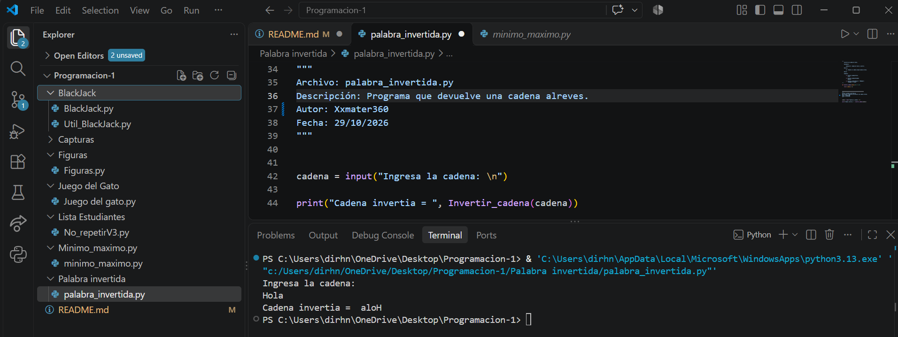

# Programación 1
Este repositorio contiene los programas y ejercicios
desarrollados durante la materia de Programación 1.

## Contenido
| Programa | Función |
| --- | --- |
| `BlackJack/BlackJack.py` | Ejecuta el juego del Blackjack |
| `BlackJack/Util_BlackJack.py` | Modulo de logica del juego |
| `Figuras/Figuras.py`| Crea figuras con simbolos |
| `Juego del Gato/Juego del gato.py`| Permite jugar al gato|
| `Lista Estudiantes/No_repetirV3.py`| Saca calificacion global e max y min de calificacion |
| `Minimo_maximo.py/minimo_maximo.py`| Saca minimos y max de una secuencia de numeros |
| `Palabra invertida/palabra_invertida.py`| Invierte una frase o palabra|
## Requisitos
Tener instalado Python 3
## Cómo ejecutar los programas
### Palabra invertido
**Requisitos**
- Tener instalado Python 3

**Ubicación:**
 `Palabra invertida/palabra_invertida.py`

**Para ejecutarlo:**
```bash
python3 palabra_invertida.py
```
## Ejemplo de funcionamiento
Al ejecutar `palabra_invertida.py` , el programa solicitara la palabra o frase a voltear.

**Ejemplo de entrada y salida:**
```text
Ingresa la cadena: Hola <-

-> Cadena invertida = aloH
```



## Autor
Diego Rafael Nava Hernández